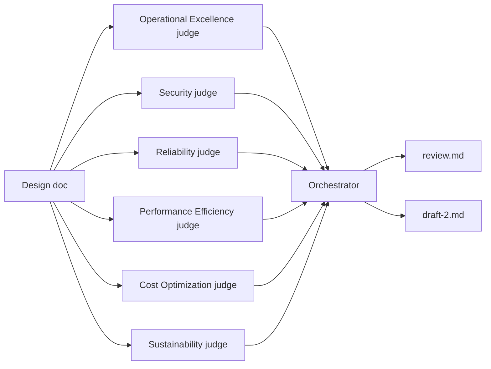

# wizengamot

> Every design doc deserves a fair hearing, before the full Wizengamot.

A [Strands Agents](https://strandsagents.com) Graph that reviews a software design document with a panel of judges defined in JSON. The default panel applies the [AWS Well-Architected Framework](https://docs.aws.amazon.com/wellarchitected/latest/framework/the-pillars-of-the-framework.html): one judge per pillar, one rubric criterion per design principle.

The judges grade the document in parallel, scoring each rubric criterion from 1 to 10. An orchestrator agent reconciles their reviews, then produces:

- **`<name>.review.md`**: a Markdown report with the verdict, scores by judge, cross-cutting themes, conflicts between judges, every finding with its status (applied, deferred, not addressed), and per-criterion evidence.
- **`<name>.draft-2.md`**: a complete revised draft of the document with the findings applied. Anything that needs a decision from the authors is left as a marked "Open question" instead of being made up.



## Setup

Requires Node 20+ and AWS credentials with access to Claude on Amazon Bedrock.

```bash
npm install
aws sso login            # or however you normally get AWS credentials
```

Check that the default model's inference profile exists in your region, and override it if the ID differs:

```bash
aws bedrock list-inference-profiles --region us-east-1 \
  --query "inferenceProfileSummaries[?contains(inferenceProfileId, 'claude')].inferenceProfileId"
```

## Usage

```bash
npm run review -- path/to/design-doc.md
npm run review -- path/to/design-doc.md --out reviews --only security,reliability
npm run review -- path/to/design-doc.md --judges my-panel.json
```

Progress prints as each judge starts and finishes. Outputs go to `./output/` by default.

## Defining judges

Judges live in [`config/judges.json`](config/judges.json), or any file passed with `--judges`. Each judge has:

| Field | Required | Meaning |
|---|---|---|
| `id` | yes | Unique slug (`cost-optimization`). Used for `--only` and the graph node ID. |
| `name` | yes | Display name in the report. |
| `prompt` | yes | The judge's own instructions: role, focus, and anything specific to its area. |
| `findingPrefix` | no | Prefix for finding IDs (`SEC` gives `SEC-1`). Defaults to the uppercased ID. |
| `rubric` | yes | One or more criteria, each graded 1–10. |

Every rubric criterion uses the same format. It must describe what a 1, a 5 and a 10 look like; the judge interpolates the grades in between:

```json
{
  "name": "Protect data in transit and at rest",
  "description": "Data classified by sensitivity; encryption, tokenization, access control and key management.",
  "anchors": {
    "1": "Sensitive data is stored or sent unprotected, or isn't identified.",
    "5": "Encryption is used, but data isn't classified or key management and rotation are unspecified.",
    "10": "Sensitive data is identified and classified, encrypted in transit and at rest, with key ownership and rotation defined."
  }
}
```

The harness appends the shared review instructions to each judge's `prompt`: the rubric with its anchors, the scoring rules, how to write findings and severities, and the output format. That way prompts stay short and every judge scores the same way. A judge can mark a criterion as not applicable instead of scoring it, and that criterion is left out of the judge's average.

The config is validated on load: missing or extra anchors, duplicate judge IDs and duplicate criteria are rejected with a message naming the field. `config/judges.schema.json` gives editors autocomplete and validation. Regenerate it with `npm run schema` after changing the format in `src/judge-config.ts`.

## Configuration

| Variable | Default | Purpose |
|---|---|---|
| `AWS_REGION` | `us-east-1` | Bedrock region |
| `WAR_JUDGE_MODEL_ID` | `global.anthropic.claude-opus-5-5` | Model for every judge |
| `WAR_ORCHESTRATOR_MODEL_ID` | `global.anthropic.claude-opus-5-5` | Model for the orchestrator |
| `WAR_JUDGE_MAX_TOKENS` | `16000` | Output cap per judge |
| `WAR_ORCHESTRATOR_MAX_TOKENS` | `64000` | Output cap for the orchestrator, which rewrites the whole document |
| `WAR_NODE_TIMEOUT_MS` | 15 min | Timeout per model call |
| `WAR_RUN_TIMEOUT_MS` | 60 min | Timeout for the whole run |

## How it works

- **`config/judges.json`**: the judge panel (see above). The default criteria use the framework's design principle names verbatim.
- **`src/judge-config.ts`**: the config format and its validation.
- **`src/judges.ts`**: builds each judge's prompt and runs it. Each judge returns a typed review (`JudgeReview` in `src/schemas.ts`): a 1–10 score (or not applicable) per criterion with evidence, findings with severity and the section they belong in, and strengths.
- **`src/orchestrator.ts`**: the graph's final node. It reads each judge's typed review straight from graph state, then asks the orchestrator agent for a `Synthesis`: verdict, themes, conflicts, applied and deferred changes, and the revised document.
- **`src/graph.ts`**: runs the configured judges in parallel and fans them in to the orchestrator.
- **`src/report.ts`**: renders the report. Each judge's score is calculated here (the mean of its applicable criteria), not taken from the model.

Design notes:

- **Failed judges don't block the report.** A Strands Graph starts a node only when all its upstream nodes completed. So each judge is a small custom node that retries once and, if it still fails, completes with the error recorded. The orchestrator runs with the remaining reviews, and the report marks that judge as "not reviewed".
- **Structured output and Claude Opus 5.5.** Strands requests structured output through a tool. If the model replies in plain text, it retries with forced tool choice, which Claude Opus 5.5 rejects. The prompts tell each agent to answer only through the output tool, so the first attempt should land. If one doesn't, that judge fails cleanly (see above).
- **Cost:** each run makes one model call per judge plus one for the orchestrator (7 with the default panel), plus retries. Every judge reads the full document, and the orchestrator reads the document plus every review and writes the full document back out.

## Tests

```bash
npm test          # offline: a fake model drives the full graph, no AWS calls
npm run typecheck
```
